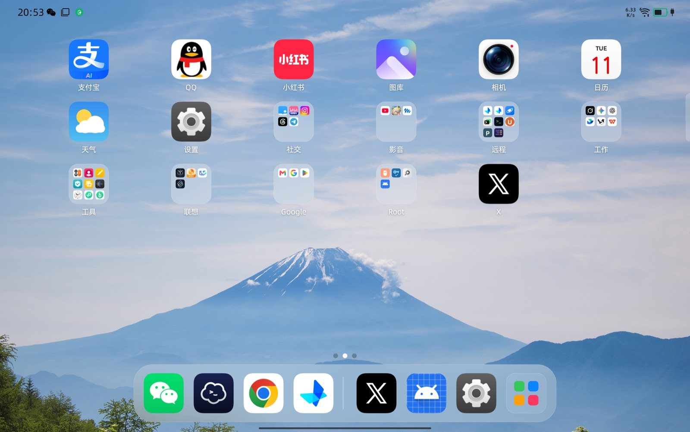
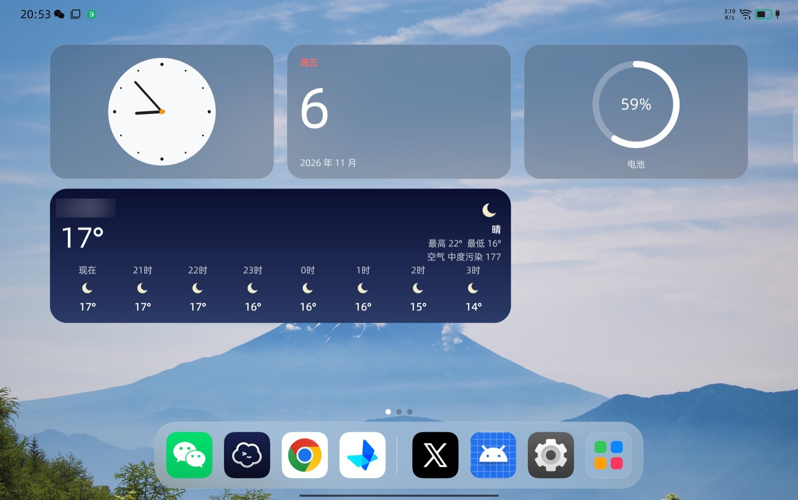
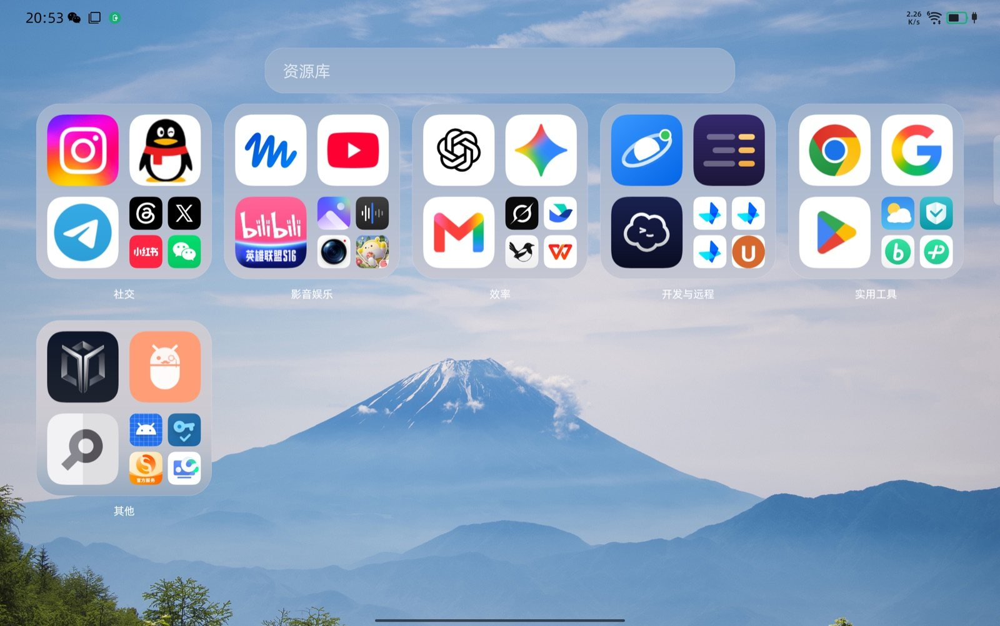
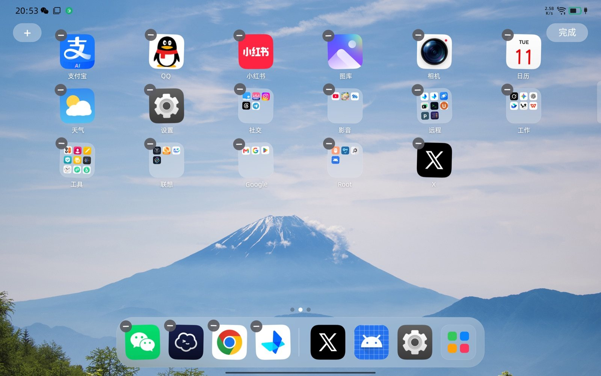
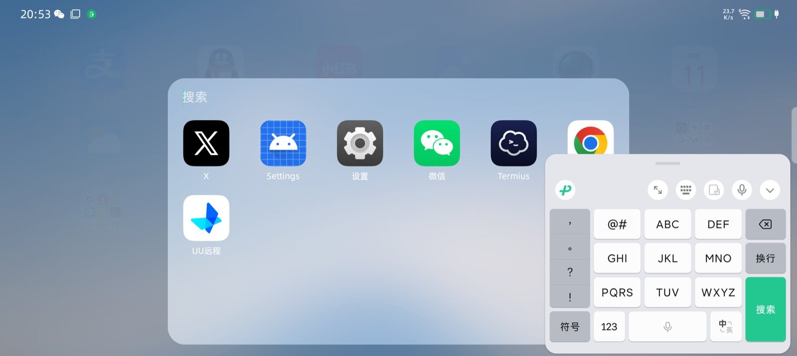

# Tessera

一个为 8.8 英寸安卓平板定制的 iPad 风格桌面。纯 Android View + Canvas 手写，没有 AndroidX、没有 Compose，安装包约 100 KB。

在 Lenovo Y700（TB323FU，Android 16，ZUI）上开发和测试。代码是原创实现，与 Apple、Lenovo 没有关联。



## 截图

| 小组件页 | 资源库 |
|---|---|
|  |  |

| 文件夹 | 编辑模式 |
|---|---|
|  |  |



截图里的应用图标和商标属于各自的权利人。

## 功能

- 连续曲率圆角图标（半径 22.37%），老式方形图标会裁边后满铺
- 悬浮毛玻璃 Dock，右侧显示最近使用的应用
- 通知红点角标
- 小组件页：内置时钟、日历、电池，也能放第三方小组件
- 资源库：应用按类别自动分组，第一格是“高频”，按最近 14 天的打开次数排序，3 天前的一次打开只算半次
- 下拉搜索，支持拼音和首字母
- 文件夹、长按快捷菜单、抖动编辑模式、拖拽排序
- 状态栏图标颜色跟随壁纸亮度切换
- 横竖屏自适应：横屏 6×5，竖屏 5×6

## 内存

在 Y700 上用 `dumpsys meminfo` 测得的 PSS：

| | Lawnchair | Tessera |
|---|---|---|
| 桌面在前台 | 约 340 MB | 约 90 MB |
| 退到后台 | 未测 | 约 32 MB |

前台数字里约 65 MB 是系统给全屏窗口分配的显示缓冲。

做法：

- 整个主屏是一个 View，不是一个图标一个控件
- 图标存在 GPU（`Bitmap.Config.HARDWARE`），LRU 上限 9 MB，退到后台降到 3 MB
- 不解码整张壁纸，毛玻璃只采样一张 1/16 的模糊小图
- 文件夹、搜索、菜单打开时才创建，关闭就销毁
- 第三方小组件只为可见页和相邻页创建 View
- 图标渲染结束后主动回收，否则解码的大图会在 native 堆积到约 100 MB

## 构建与安装

需要 JDK 17 和 Android SDK 36。

```bash
./gradlew :app:assembleRelease
adb install -r app/build/outputs/apk/release/app-release.apk
```

授权并设为默认桌面：

```bash
adb shell appops set app.homepad GET_USAGE_STATS allow
adb shell appops set app.homepad MANAGE_EXTERNAL_STORAGE allow
adb shell appwidget grantbind --package app.homepad --user 0
adb shell cmd notification allow_listener app.homepad/app.homepad.BadgeService
adb shell cmd role add-role-holder android.app.role.HOME app.homepad
adb shell am force-stop com.zui.launcher
```

包名是 `app.homepad`，这是项目改名前的名字，保留它是为了能覆盖安装。

首次运行的布局写在 `Model.kt` 的 `seed` 里，是作者自己的应用排布，换设备时改这里。

## ZUI 上的注意事项

- 系统的手势上滑和多任务由 `com.zui.launcher` 提供，不能卸载它。只禁用桌面入口：

  ```bash
  adb shell su -c 'pm disable com.zui.launcher/.drawer.NormalLauncher'
  ```

- 换默认桌面后要重启一次 ZUI Launcher，否则上滑还会回到旧桌面。
- ZUI 会弹窗询问“读取应用列表”，允许之前系统返回的应用列表是空的。

恢复 ZUI 桌面：

```bash
adb shell su -c 'pm enable com.zui.launcher/.drawer.NormalLauncher'
adb shell cmd role add-role-holder android.app.role.HOME com.zui.launcher
```

## 字体

截图使用阿里巴巴普惠体 3.0，由设备上的 Magisk 模块全局替换。字体不在这个仓库里，请到[官网](https://www.alibabafonts.com/)下载。不装这个字体，桌面也能正常运行。

## 已知限制

- 状态栏、通知中心、控制中心、锁屏和多任务界面仍是系统的
- 这台设备不支持跨窗口模糊，毛玻璃是壁纸采样，不会模糊背后的图标
- 拖拽排序和添加小组件还没在真机上完整测试
